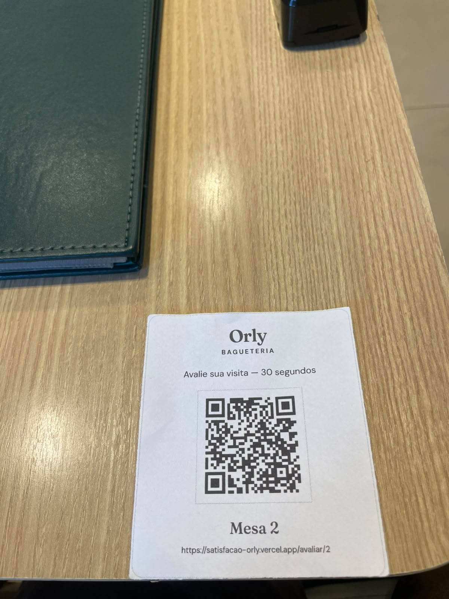
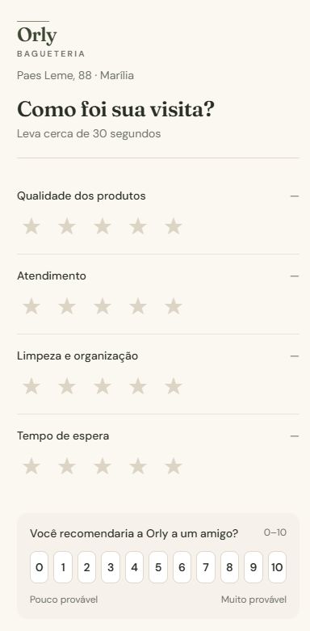
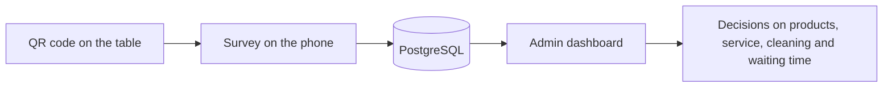
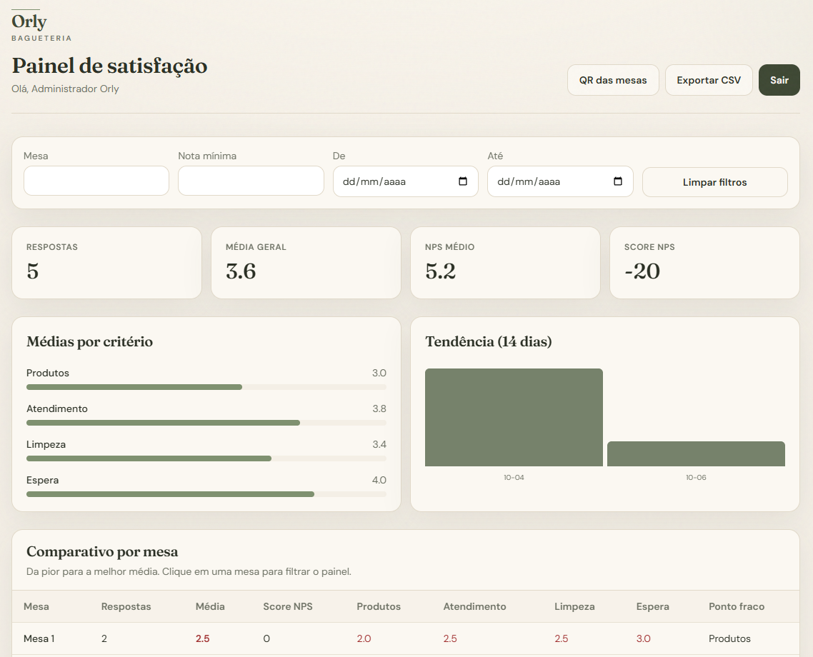
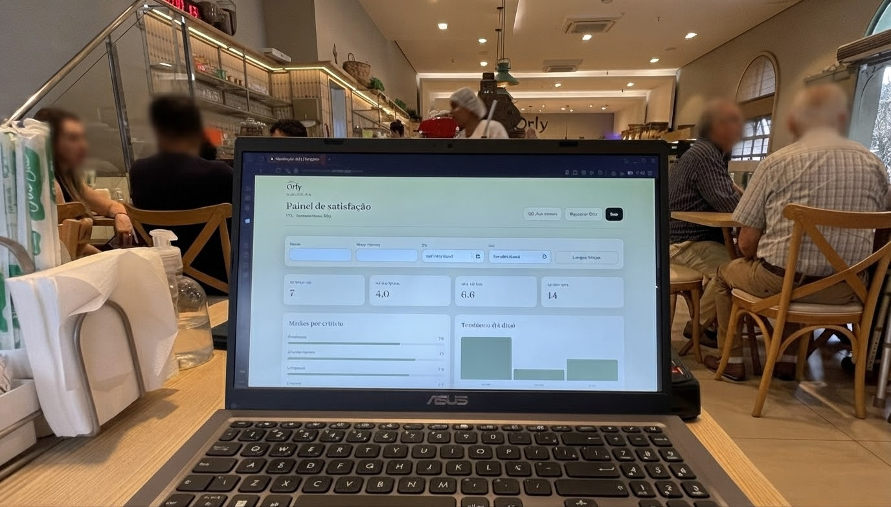
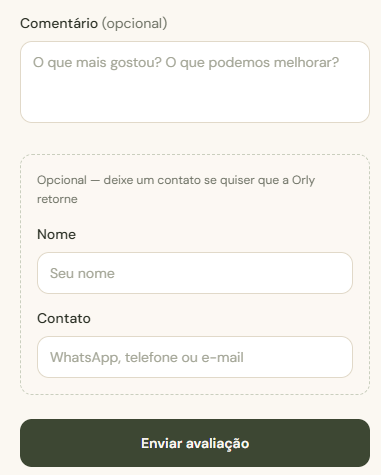

<div align="center">

# Satisfação Orly

**QR code customer satisfaction survey for Orly Bagueteria — Marília/SP, Brazil**

[](https://github.com/M4dri1/satisfacao-orly/actions/workflows/ci.yml)


[**Live app**](https://satisfacao-orly.vercel.app) · [English](#english) · [Português](#português)


&nbsp;&nbsp;


</div>



---

## English

### About

Satisfação Orly is a web system that lets customers of **Orly Bagueteria**, a 54-year-old traditional bakery in Marília/SP, rate their visit right at the table. Each table has its own QR code: the customer scans it with the phone camera, answers a 30-second survey and the management team follows the results on a password-protected dashboard.

It was built as a university **extension project** for the Computer Science program (8th term), from August 18 to October 10, 2026, and is in use at the bakery.

### The problem

Customer feedback used to arrive informally at the counter or as public online reviews, with no data to track service quality over time or to know which area of the store needed attention.

### Features

**For customers**

- One QR code per table — no app, no sign-up
- 1 to 5 star ratings for products, service, cleanliness and waiting time
- Net Promoter Score question (0 to 10)
- Optional comment and optional contact for the bakery to reply

**For management**

- Total responses, overall average, average NPS and NPS score
- Average per criterion and 14-day trend
- Per-table comparison, sorted from worst to best, showing each table's weakest criterion
- Filters by table, minimum rating and date range
- Comment list and CSV export
- Printable QR code cards for all tables

**Security**

- JWT session in an httpOnly cookie
- Per-network rate limit backed by Redis
- Input validation with Zod and a honeypot field against bots

### Screenshots

<p align="center">
  
</p>
<p align="center">
  
  &nbsp;
  
</p>

### Tech stack

| Layer | Technology |
|---|---|
| Front end | Next.js 14 (App Router), React, Tailwind CSS |
| Back end | Next.js route handlers, TypeScript |
| Database | PostgreSQL with Prisma ORM |
| Rate limit | Redis |
| Tests | Vitest and an end-to-end report audit |
| Hosting | Vercel |

### Project structure

```
app/avaliar        customer survey
app/admin          dashboard and QR codes
app/api            HTTP routes
components         UI components
lib/services       business rules
lib/repositories   database access
prisma             schema and migrations
scripts            report audit
```

Routes only receive and respond; business rules live in `lib/services` and database access in `lib/repositories`.

### Getting started

Requirements: Node.js 20+ and Docker Desktop.

```bash
cp .env.example .env
npm install
npm run setup
npm run dev
```

| URL | Purpose |
|---|---|
| http://localhost:3000/avaliar | Customer survey |
| http://localhost:3000/admin/login | Admin dashboard |

The admin login uses `ADMIN_EMAIL` and `ADMIN_PASSWORD` from `.env`.

### Scripts

| Command | Description |
|---|---|
| `npm run setup` | Starts Postgres and Redis in Docker, applies migrations and creates the admin |
| `npm run dev` | Starts the development server |
| `npm test` | Unit tests for the metrics |
| `npm run test:reports` | Audits the reports against the running app |
| `npm run lint` | Lints the code |
| `npm run build` | Production build |

---

## Português

### Sobre

O Satisfação Orly é um sistema web para os clientes da **Orly Bagueteria**, padaria tradicional de Marília/SP com 54 anos de história, avaliarem a visita na própria mesa. Cada mesa tem um QR Code: o cliente lê com a câmera do celular, responde uma pesquisa de cerca de 30 segundos e a gestão acompanha os resultados num painel protegido por senha.

Foi desenvolvido como **projeto de extensão** do curso de Ciência da Computação (8ª etapa), de 18 de agosto a 10 de outubro de 2026, e está em uso na padaria.

### O problema

As opiniões dos clientes chegavam de forma espontânea no balcão ou em avaliações públicas na internet, sem dados para acompanhar a qualidade do atendimento ao longo do tempo nem saber qual área da loja precisava de atenção.

### Funcionalidades

**Para o cliente**

- Um QR Code por mesa, sem aplicativo e sem cadastro
- Notas de 1 a 5 estrelas para produtos, atendimento, limpeza e tempo de espera
- Pergunta de NPS (0 a 10)
- Comentário e contato opcionais para a Orly retornar

**Para a gestão**

- Total de respostas, média geral, NPS médio e Score NPS
- Médias por critério e tendência dos últimos 14 dias
- Comparativo por mesa, da pior para a melhor, com o ponto fraco de cada mesa
- Filtros por mesa, nota mínima e período
- Lista de comentários e exportação em CSV
- Cartões com QR Code de todas as mesas prontos para imprimir

**Segurança**

- Sessão com JWT em cookie httpOnly
- Limite de envios por rede com Redis
- Validação dos dados com Zod e campo honeypot contra robôs

### Tecnologias

| Camada | Tecnologia |
|---|---|
| Interface | Next.js 14 (App Router), React, Tailwind CSS |
| Servidor | Rotas do Next.js, TypeScript |
| Banco de dados | PostgreSQL com Prisma |
| Limite de envios | Redis |
| Testes | Vitest e auditoria dos relatórios |
| Hospedagem | Vercel |

### Como rodar

Requisitos: Node.js 20+ e Docker Desktop.

```bash
cp .env.example .env
npm install
npm run setup
npm run dev
```

| Endereço | Uso |
|---|---|
| http://localhost:3000/avaliar | Formulário do cliente |
| http://localhost:3000/admin/login | Painel administrativo |

O login do painel usa `ADMIN_EMAIL` e `ADMIN_PASSWORD` do `.env`.

### Comandos

| Comando | O que faz |
|---|---|
| `npm run setup` | Sobe Postgres e Redis no Docker, aplica as migrations e cria o admin |
| `npm run dev` | Inicia o sistema em modo de desenvolvimento |
| `npm test` | Testes automatizados das métricas |
| `npm run test:reports` | Confere os relatórios com o sistema rodando |
| `npm run lint` | Verificação do código |
| `npm run build` | Build de produção |

---

## Team / Grupo

| Name / Nome | Role / Papel |
|---|---|
| Kayky Leite | Student / Aluno |
| Gabriel Araujo | Student / Aluno |
| Gabriel Reis | Student / Aluno |
| Samira Eduarda | Student / Aluna |
| Everton Simões da Motta | Advisor / Professor orientador |

Partner / Parceiro: **Orly Bagueteria** — Marília/SP
